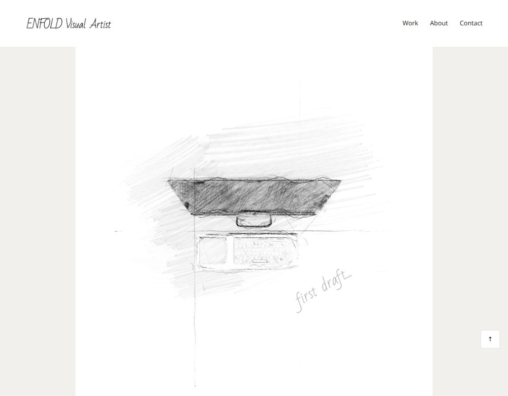

# Enfold-inspired portfolio layout



An HTML/CSS portfolio layout study with bundled photography, icons and Open Sans / Bad Script fonts.

## Run locally

Requires Python 3 for the optional static server. From this repository folder:

```bash
python -m http.server 8000
```

Open http://localhost:8000. No deployment is required.

## Repository structure

- `index.html` — page markup
- `css/css p.css` — original stylesheet path
- `script.js` — mobile menu and local form feedback
- `images/` and `icons/` — artwork
- `fonts/` — bundled fonts and their OFL notices
- `docs/` — import provenance and review notes

## Scope and dependencies

Navigation and contact controls validate the form locally. No message delivery service is included. Enfold branding and artwork belong to their respective owners; font license notices are preserved.

## Validation

Local HTML/CSS asset references and JavaScript syntax are checked during the import. See `docs/VALIDATION.md` for the actual results and limits. CI is defined in `.github/workflows/quality.yml`.

## Source preservation

All original project files were imported in a separate Git commit before changes. `docs/ORIGINAL_FILES.sha256` lists the archive file checksums. Existing images, fonts and notices are retained. No repository-wide license grant has been added.
